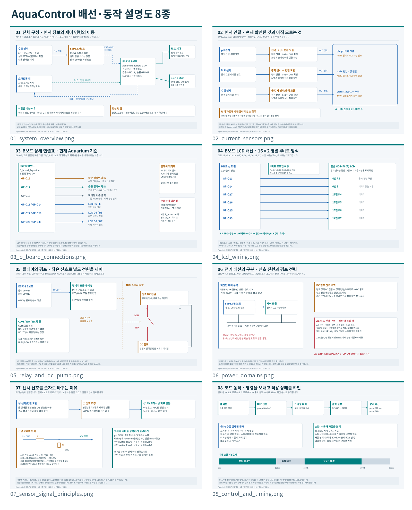

# AquaControl 배선·코드 설명 자료

앱 v1.3.8 / Aquarium B v1.1.0 기준으로 작성한 **PNG 8장과 TXT 4개**입니다. PPT 파일은 포함하지 않습니다.

[전체 ZIP 다운로드](https://raw.githubusercontent.com/ericalapiestral-hash/A1/main/docs/explainer_2026-10-15/AquaControl-Explanation-2026-10-15.zip)

## TXT 설명서

- [먼저 읽기](00_먼저읽기.txt): 파일 구성과 적용 범위
- [센서·전기·배선·코드 상세 설명](01_상세설명_센서_전기_배선_코드.txt): 각 장치와 파일·함수의 역할, 선택한 이유, 전기 기초
- [발표 대본·그림 설명·예상 질문](02_발표대본_그림설명_예상질문.txt): 비전공자가 말로 설명하기 위한 문장
- [장치 목록·배선 확인표](03_장치목록_배선확인표.txt): 확정 내용과 실물 확인 항목

TXT는 UTF-8 BOM / CRLF 형식이며 Windows 메모장에서 열 수 있습니다. 개별 PNG는 2560×1440입니다.

## 개별 그림

1. [전체 구성](images/01_system_overview.png)
2. [현재 센서 연결과 확인 범위](images/02_current_sensors.png)
3. [B보드 핀 연결](images/03_b_board_connections.png)
4. [B LCD 신호선](images/04_lcd_wiring.png)
5. [릴레이와 DC 펌프 원리](images/05_relay_and_dc_pump.png)
6. [전원 구역 구분](images/06_power_domains.png)
7. [센서 신호와 분압 원리](images/07_sensor_signal_principles.png)
8. [명령 처리와 순환 타이머](images/08_control_and_timing.png)

## 확인 범위

그림은 코드와 확인된 사실을 바탕으로 만든 설명도이며 실물 사진·전체 실측 회로도는 아닙니다. 순환 v1.0.1의 실제 작동은 사용자 확인을 받았고, 새 급수 v1.1.0은 코드·앱·모의 설치 검증과 배포를 완료했습니다. 새 급수의 실제 설치·작동 결과는 아직 전달받지 못했습니다.

실제 A의 원본 소스, 센서 GPIO·모델, 펌프 명판, 릴레이 접점은 미확인입니다. 별도 저장소 A/B 설계와 현재 Aquarium 경로를 구분했습니다. 원리 예시를 현재 실물 배선으로 단정하지 않습니다.

분석 소스: [`8cde2fb`](https://github.com/ericalapiestral-hash/A1/tree/8cde2fb3a084ad7a56a580b6874f041b6848edde). 그림 생성 코드는 `build_diagrams.py`이며 Pillow와 Noto Sans CJK 폰트를 사용합니다. ZIP에는 PNG/TXT만 들어 있습니다.

ZIP: 2,293,427바이트. SHA-256: `d38f36dced6f9e0d80a63ed7e757f48c07f5617111b4535f51927bccf7777ed1`.
